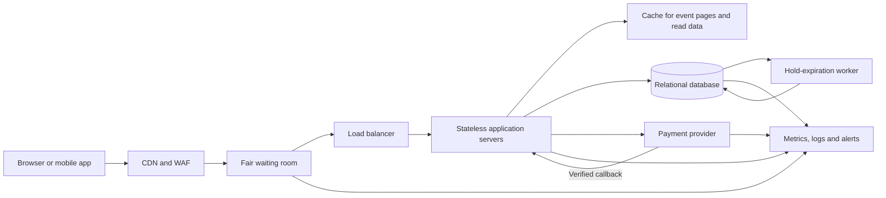

# TicketHub Ticketing System Design

## 1. Requirements

### Functional requirements

- Visitors can browse and search events and view event details.
- Visitors can see the seats and prices for an event.
- Signed-in users can temporarily hold available seats, pay for them, and view their bookings or tickets.
- Users can cancel where the event's cancellation policy allows it.
- Staff can create events, configure seats and prices, and inspect orders.
- The system sends a booking confirmation after payment is confirmed.

### Non-functional requirements

| Goal | Design target |
|---|---|
| Speed | Event pages should usually load in under 2 seconds. Seat availability and hold requests should usually respond in under 500 ms, excluding the payment provider. |
| Correctness | A seat can have at most one active hold or one completed sale. A ticket is issued only for a confirmed payment. |
| Reliability | The site should remain useful during a sale, give clear retry or queue status, and recover safely from failed requests and payment callbacks. |
| Security | Require authentication for holds and bookings; authorize each user's booking access; validate input; protect personal data; use HTTPS; never store card numbers or security codes. |
| Fairness | Admit buyers using a visible, time-ordered waiting room, apply the same limits to everyone, and limit automated abuse without allowing refresh speed to decide who gets a seat. |

## 2. Traffic estimates

These are average rates over the stated time periods, not promises about instantaneous peaks. I use 86,400 seconds in a day and decimal counts. The 2 million registered users are the account base; they are not assumed to be online at once.

### Normal day

1. **Page views:** 50,000 daily visitors × 10 pages each = **500,000 page views/day**.
2. **Page-view rate:** 500,000 ÷ 86,400 = **5.8 page views/second** on average.
3. For a rough API estimate, assume two API calls per page view (for example, event data and availability), with static files delivered separately: 500,000 × 2 ÷ 86,400 = **11.6 API requests/second** on average.
4. **Sales:** 5,000 tickets/day ÷ 86,400 = **0.058 tickets/second**, or about **one ticket every 17 seconds** averaged across the day. If an average order contains two tickets, this is about 2,500 orders/day, or 0.029 orders/second.

Real traffic has daily peaks, and a checkout also makes calls that are not represented by the page-view estimate. These estimates are a baseline for capacity planning, not an exact workload.

### Popular concert sale

1. **Buyers arriving:** 200,000 people ÷ (10 × 60 seconds) = **about 333 people/second** on average during the sale.
2. **Seats available:** 20,000 ÷ 600 = **about 33 seats/second** must be sold on average to sell out in ten minutes.
3. **Demand compared with supply:** 200,000 ÷ 20,000 = **10 buyers per seat**. Up to 180,000 people cannot get one of these seats.
4. If each buyer makes four API requests during an attempted purchase (for example, event/seat lookup, hold, payment initiation, and booking check), an unthrottled arrival could mean **about 1,333 API requests/second**. Retries and page activity could make it higher.

The estimated unthrottled sale API rate is about 115 times the normal average API rate (1,333 ÷ 11.6). A waiting room admits a controlled number of buyers at a time; excess demand stays queued instead of overwhelming the application or database. Capacity should be tested for short bursts, not only these ten-minute averages.

## 3. REST API

Requests and responses use JSON. The examples use illustrative IDs. Authenticated endpoints require a valid user session or access token. A hold endpoint accepts an `Idempotency-Key` so a client retry does not accidentally create a second order.

| Method and endpoint | Purpose and example | Success | Relevant errors |
|---|---|---|---|
| `GET /api/events?query=jazz&date=2026-11-01` | Browse/search events. Example: `curl "https://api.tickethub.example/api/events?query=jazz"` | `200 OK` with event summaries | `400 Bad Request` for an invalid date or query |
| `GET /api/events/{eventId}/seats` | View seat labels, prices, and current availability. Example: `GET /api/events/evt_42/seats` | `200 OK` | `404 Not Found` if the event does not exist |
| `POST /api/holds` | Temporarily hold seats. Example body: `{"eventId":"evt_42","seatIds":["seat_A1","seat_A2"]}` | `201 Created` with `orderId` and `expiresAt` | `401 Unauthorized`; `409 Conflict` if any seat is no longer available; `422 Unprocessable Entity` for invalid seat selection |
| `POST /api/orders/{orderId}/payment` | Start payment for an active hold. Example body: `{"paymentMethodToken":"pm_token_from_provider"}` | `202 Accepted` with payment status; payment may require asynchronous confirmation | `401 Unauthorized`; `404 Not Found`; `409 Conflict` if the hold expired; `402 Payment Required` or `422 Unprocessable Entity` for a declined/invalid payment |
| `GET /api/orders/{orderId}` | View the authenticated user's order and payment status. Example: `GET /api/orders/ord_91` | `200 OK` | `401 Unauthorized`; `404 Not Found` if missing or not accessible to this user |
| `GET /api/me/tickets` | List the signed-in user's confirmed tickets. Example: `GET /api/me/tickets` | `200 OK` | `401 Unauthorized` |

A `409 Conflict` response should explain that a seat was taken and invite the user to choose another. Do not return another user's personal or payment details in any error.

## 4. Relational data model

The database is the source of truth for seat ownership and payment status. IDs below can be UUIDs or other unique identifiers.

```sql
Users(
  id                 PRIMARY KEY,
  email              UNIQUE NOT NULL,
  password_hash      NOT NULL,
  created_at         NOT NULL
)

Events(
  id                 PRIMARY KEY,
  title              NOT NULL,
  venue              NOT NULL,
  starts_at          NOT NULL,
  status             NOT NULL
)

Orders(
  id                 PRIMARY KEY,
  user_id            NOT NULL REFERENCES Users(id),
  status             NOT NULL, -- PENDING, PAYMENT_PENDING, CONFIRMED, EXPIRED, FAILED
  hold_expires_at,
  idempotency_key    UNIQUE NOT NULL,
  payment_reference  UNIQUE,
  created_at         NOT NULL
)

Seats(
  id                 PRIMARY KEY,
  event_id           NOT NULL REFERENCES Events(id),
  seat_label         NOT NULL,
  price_cents        NOT NULL,
  status             NOT NULL, -- AVAILABLE, HELD, SOLD
  held_by_user_id    REFERENCES Users(id),
  hold_expires_at,
  current_order_id   REFERENCES Orders(id),
  UNIQUE(event_id, seat_label)
)

OrderItems(
  id                 PRIMARY KEY,
  order_id           NOT NULL REFERENCES Orders(id),
  seat_id            NOT NULL REFERENCES Seats(id),
  price_cents        NOT NULL,
  UNIQUE(order_id, seat_id)
)

Tickets(
  id                 PRIMARY KEY,
  order_item_id      UNIQUE NOT NULL REFERENCES OrderItems(id),
  ticket_code        UNIQUE NOT NULL,
  status             NOT NULL
)
```

`Users` has a one-to-many relationship with `Orders`; each order belongs to one user. `Events` has a one-to-many relationship with `Seats`; the unique event/seat-label pair prevents duplicate seat definitions for an event. `Orders` and `Seats` are connected through `OrderItems`, allowing one order to contain multiple seats. `OrderItems.price_cents` records the price agreed at purchase time even if an event's listed price later changes. The seat's `current_order_id`, status, and expiration describe only its current hold or sale; old order records remain as history.

Each confirmed order item can have at most one ticket because `Tickets.order_item_id` is unique. The unique ticket code supports ticket lookup and validation. The unique order idempotency key lets the API return the original order when a client safely retries a hold request.

## 5. Preventing double-booking

Caching helps serve event information quickly, but it is **not** the mechanism that prevents two people buying the same seat. The relational database is authoritative.

1. The application validates the user, event, seat IDs, and requested quantity. It starts a database transaction, creates a pending order, and locks requested seat rows in a consistent order (for example, ascending seat ID) to reduce deadlocks.
2. For each seat, it performs a conditional update equivalent to:

   ```sql
   UPDATE Seats
   SET status = 'HELD',
       held_by_user_id = :user_id,
       hold_expires_at = :expires_at,
       current_order_id = :order_id
   WHERE id = :seat_id
     AND (
       status = 'AVAILABLE'
       OR (status = 'HELD' AND hold_expires_at <= CURRENT_TIMESTAMP)
     );
   ```

   The application checks that exactly one row was updated for every requested seat. If any update affects zero rows, it rolls back the whole transaction and returns `409 Conflict`; it does not keep only part of a multi-seat request.
3. If every seat is held, the same transaction creates its `OrderItems` and commits. If any requested seat could not be held, the transaction rolls back, including the pending order. A short hold (for example, five minutes) gives the buyer time to pay. The exact duration is a product decision.
4. If two buyers request the same seat simultaneously, the row lock/conditional update serializes the changes. The first transaction to successfully update and commit the available seat owns its hold. The other transaction then sees that the seat is held and unexpired, updates zero rows, and receives `409 Conflict`. The unique seat definition also prevents duplicate inventory rows.
5. The payment provider processes payment using a tokenized payment method. A verified provider callback (or a verified status lookup) confirms payment. In a transaction, the application locks the order and its seats, checks that the order is still pending and the hold is still current, then marks the order `CONFIRMED` and seats `SOLD` and creates one ticket per order item. A unique provider payment reference and a state check make callback handling idempotent, so duplicate callbacks cannot create duplicate tickets.
6. An expiration worker finds elapsed holds and atomically marks eligible pending orders `EXPIRED` and releases only seats still pointing to those orders. This conditional check prevents a delayed expiry job from releasing seats that have since been held by someone else. If payment completes after the hold has expired, the system must not sell the seat from that stale hold; it voids or refunds the payment and reports the result to the customer.

The conditional update and transaction are essential even if the waiting room limits traffic: simultaneous requests can still reach the database.

## 6. Architecture and sale traffic



- **CDN and WAF:** Serve static assets close to users and filter common malicious or abusive traffic. They do not decide seat ownership.
- **Fair waiting room:** Assigns queue positions or signed queue tokens using one consistent arrival policy, shows progress, and admits traffic at a rate the application and database can handle. Rate limits and bot checks use consistent rules rather than refresh speed.
- **Load balancer and stateless application servers:** Spread admitted requests over multiple replaceable servers. The servers validate requests, enforce authorization, and run the booking workflow; they do not keep seat ownership only in memory.
- **Cache:** Speeds up mostly-read event descriptions and non-authoritative displays. Seat availability can change quickly, so the UI labels it as a snapshot; a successful database hold is the only reservation confirmation.
- **Relational database:** Persists users, event inventory, orders, and seat state. The primary database handles seat holds and sales with transactions and conditional updates.
- **Payment provider:** Handles sensitive card processing. TicketHub stores provider references and payment status, not raw card details; verified callbacks update order status.
- **Hold-expiration worker:** Releases timed-out holds safely and can retry work that fails temporarily.
- **Monitoring:** Tracks queue length and wait time, API latency/error rate, database load and lock conflicts, payment failures, and confirmed orders. Alerts help operators respond before customers are affected.

For the sale, TicketHub queues the large arrival wave and gradually admits buyers, scales application servers horizontally, and caches event details. It keeps inventory writes on the authoritative database and limits concurrent holds to tested database capacity. Monitoring and clear queue status help the team detect overload without falsely claiming seats have been purchased.

## 7. Trade-offs

### Waiting room versus letting everyone in immediately

- **Benefit:** Protects the database and gives buyers a consistent, explainable admission process under a sudden burst.
- **Cost:** Customers wait, and the experience depends on reliable queue infrastructure. A queue limits overload but does not create more seats or guarantee every visitor a ticket.

### Short seat holds versus longer holds

- **Benefit of short holds:** Seats return to inventory quickly when someone abandons checkout, giving other buyers a chance.
- **Cost:** A buyer with a slow connection or payment step may lose a seat. Longer holds are friendlier to an individual but leave inventory unavailable longer and reduce the number of buyers who can try.

### Cached availability versus live database reads

- **Benefit of caching:** Makes event and seat-map pages faster and reduces read load during a sale.
- **Cost:** A cached seat map can briefly show a seat as available after another buyer has held it. The hold endpoint must check the database and return a conflict when needed; the UI should refresh availability rather than treating cached data as a guarantee.

## 8. Conclusion

TicketHub serves normal browsing with cached reads and handles sale surges with a fair waiting room, horizontally scaled application servers, and monitoring. The relational database protects scarce inventory through transactional conditional updates, row locks, and expiring holds. Payment confirmation is verified and idempotent, and a ticket is issued only after the order and seat states are safely confirmed.
